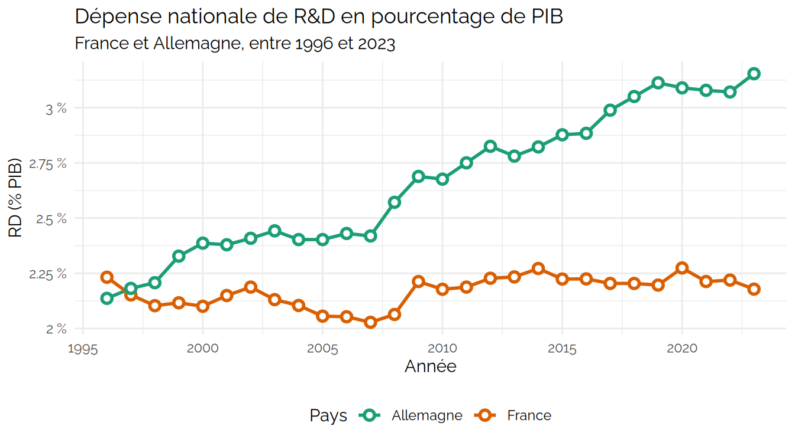
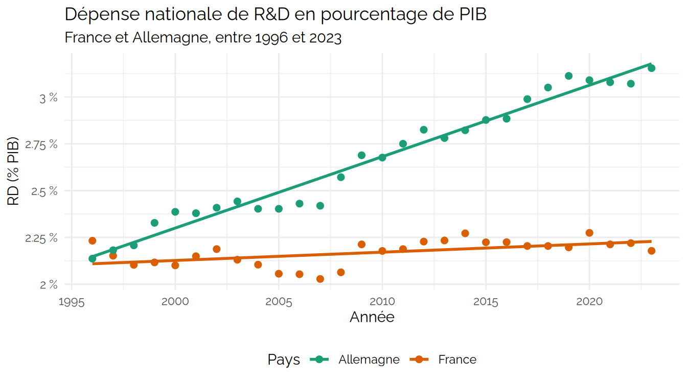
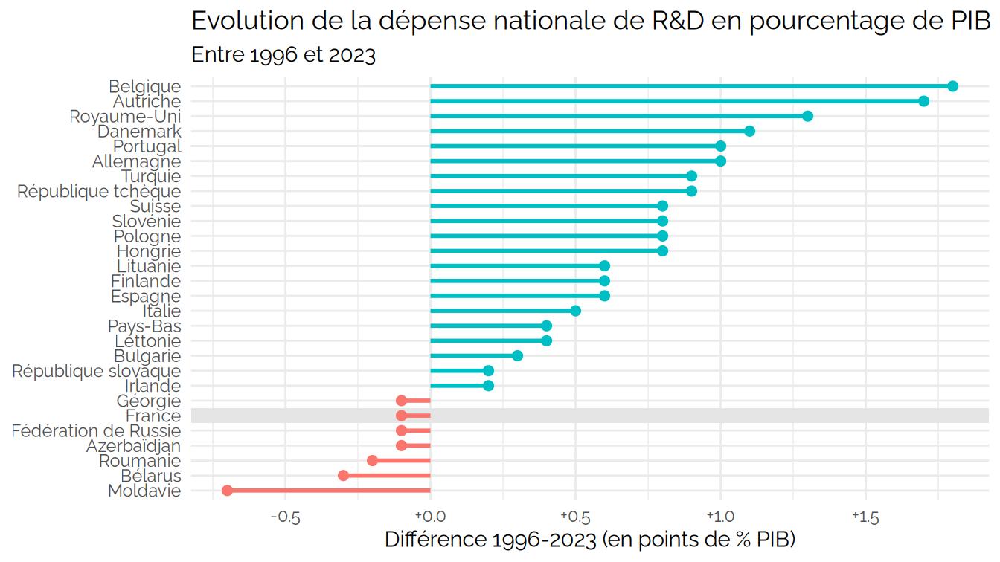
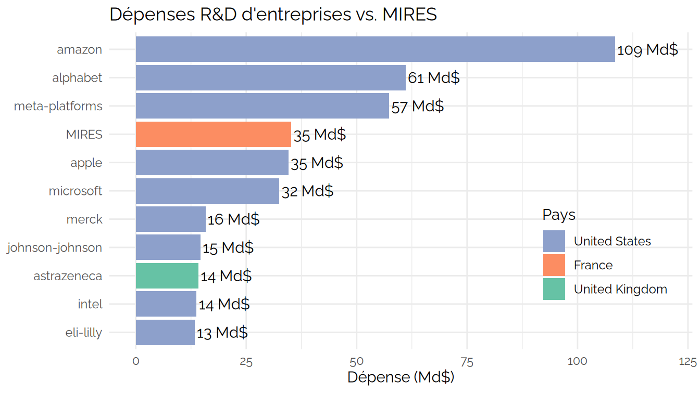
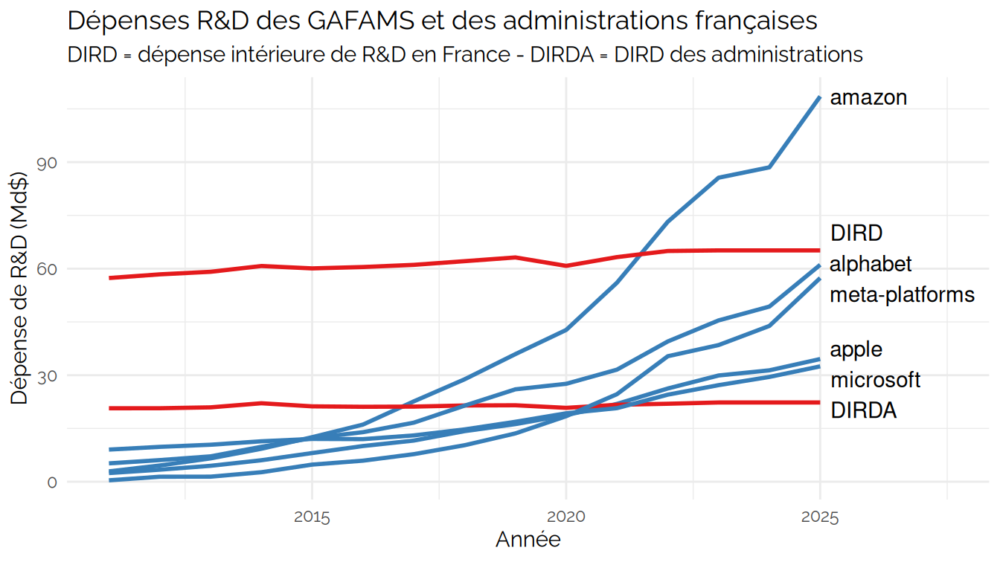

CPESR
================
CPESR
2026-09-01

## Données

## Explorations

    ## [Télécharger les données]( RD_files/figure-data/unnamed-chunk-1.csv )

    ## Warning: Using `size` aesthetic for lines was deprecated in ggplot2 3.4.0.
    ## ℹ Please use `linewidth` instead.
    ## This warning is displayed once every 8 hours.
    ## Call `lifecycle::last_lifecycle_warnings()` to see where this warning was
    ## generated.

    ## [Télécharger les données]( RD_files/figure-data/unnamed-chunk-2.csv )

    ## `geom_smooth()` using formula = 'y ~ x'

    ## [Télécharger les données]( RD_files/figure-data/unnamed-chunk-3.csv )

## Corporation

    ## [Télécharger les données]( RD_files/figure-data/unnamed-chunk-4.csv )

    ## [Télécharger les données]( RD_files/figure-data/unnamed-chunk-5.csv )

