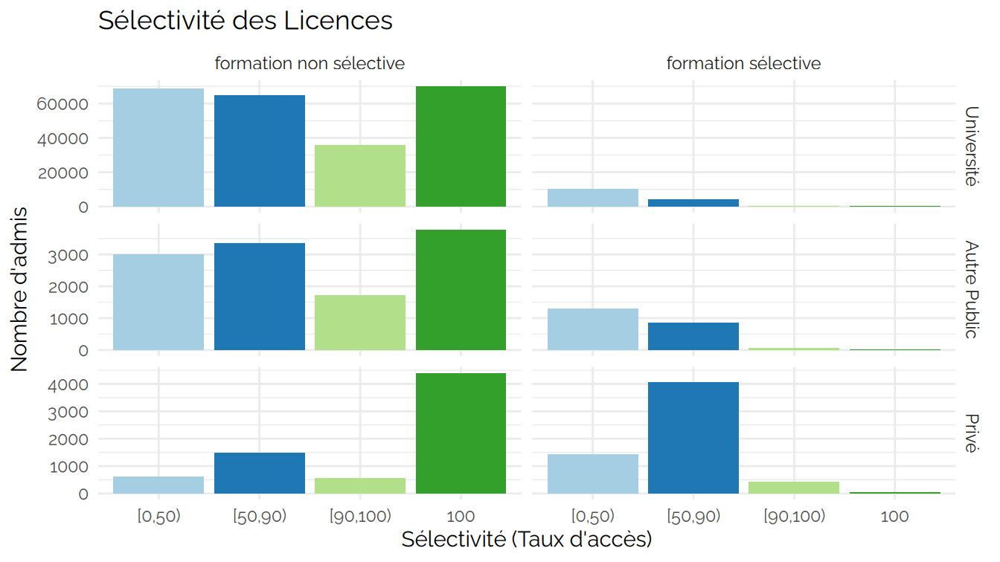
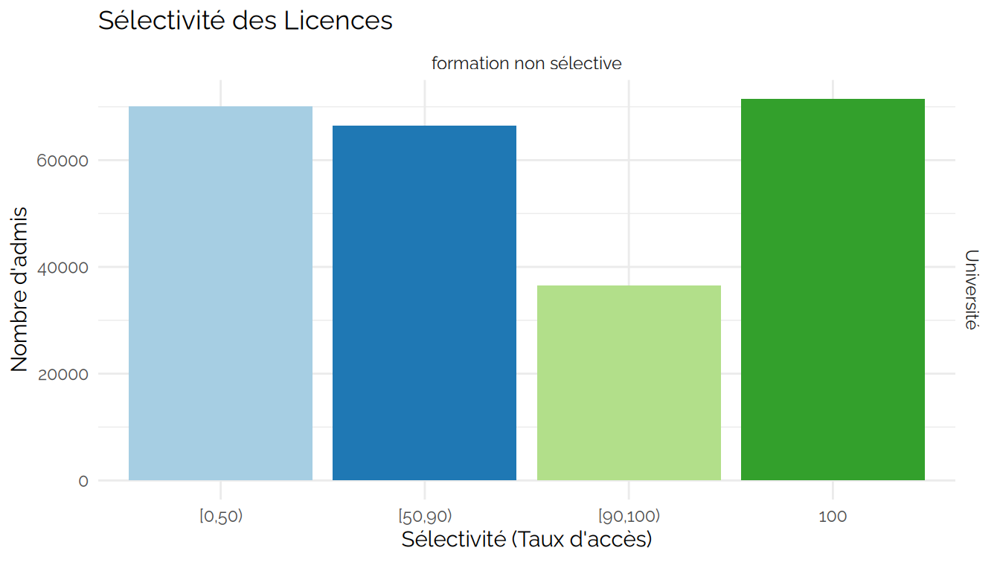
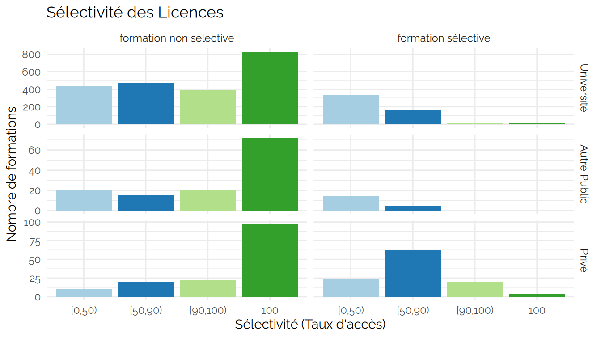
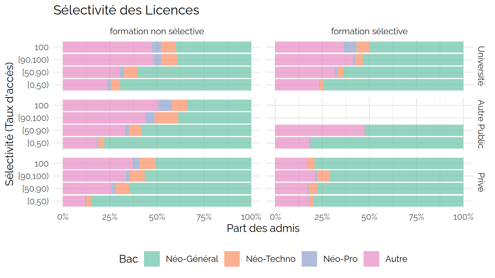
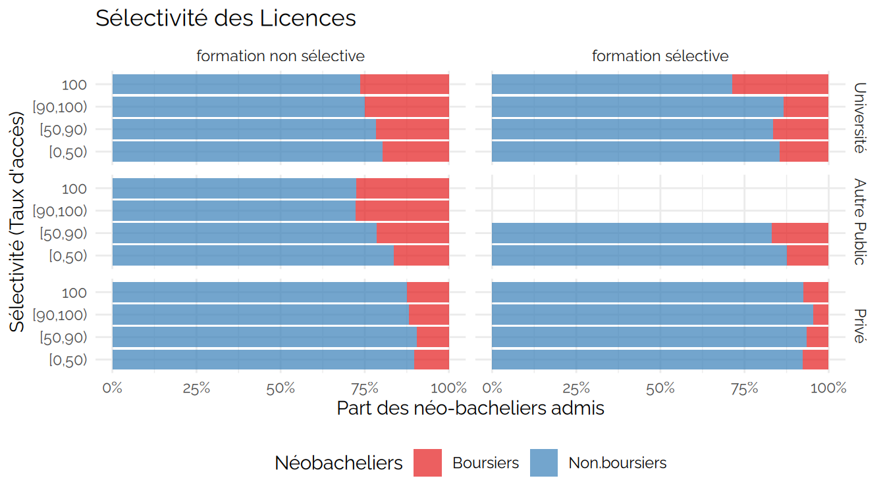

CPESR
================
CPESR
2026-10-18

## Données

- <https://data.enseignementsup-recherche.gouv.fr/explore/assets/fr-esr-parcoursup/export/>

## Explorations

Données unnamed-chunk-1 ( 22 lignes)

| Secteur | Sélectivité.officielle | Sélectivité.réelle | Nombre.formations | Nombre.admis | Part.formations | Part.admis |
|:---|:---|:---|---:|---:|---:|---:|
| Université | formation non sélective | \[0,50) | 434 | 70146 | 0.2039474 | 0.2868734 |
| Université | formation non sélective | \[50,90) | 472 | 66407 | 0.2218045 | 0.2715822 |
| Université | formation non sélective | \[90,100) | 393 | 36521 | 0.1846805 | 0.1493585 |
| Université | formation non sélective | 100 | 829 | 71445 | 0.3895677 | 0.2921859 |
| Université | formation sélective | \[0,50) | 334 | 11047 | 0.6435453 | 0.6778964 |
| Université | formation sélective | \[50,90) | 166 | 4678 | 0.3198459 | 0.2870643 |
| Université | formation sélective | \[90,100) | 12 | 252 | 0.0231214 | 0.0154639 |
| Université | formation sélective | 100 | 7 | 319 | 0.0134875 | 0.0195754 |
| Autre Public | formation non sélective | \[0,50) | 20 | 1662 | 0.1574803 | 0.2263688 |
| Autre Public | formation non sélective | \[50,90) | 15 | 1946 | 0.1181102 | 0.2650504 |
| Autre Public | formation non sélective | \[90,100) | 20 | 1199 | 0.1574803 | 0.1633070 |
| Autre Public | formation non sélective | 100 | 72 | 2535 | 0.5669291 | 0.3452738 |
| Autre Public | formation sélective | \[0,50) | 14 | 534 | 0.7368421 | 0.5798046 |
| Autre Public | formation sélective | \[50,90) | 5 | 387 | 0.2631579 | 0.4201954 |
| Privé | formation non sélective | \[0,50) | 10 | 629 | 0.0671141 | 0.0888167 |
| Privé | formation non sélective | \[50,90) | 20 | 1484 | 0.1342282 | 0.2095453 |
| Privé | formation non sélective | \[90,100) | 22 | 568 | 0.1476510 | 0.0802033 |
| Privé | formation non sélective | 100 | 97 | 4401 | 0.6510067 | 0.6214346 |
| Privé | formation sélective | \[0,50) | 23 | 1438 | 0.2110092 | 0.2405487 |
| Privé | formation sélective | \[50,90) | 62 | 4057 | 0.5688073 | 0.6786551 |
| Privé | formation sélective | \[90,100) | 20 | 435 | 0.1834862 | 0.0727668 |
| Privé | formation sélective | 100 | 4 | 48 | 0.0366972 | 0.0080294 |

Données unnamed-chunk-2 ( 4 lignes)

| Secteur | Sélectivité.officielle | Sélectivité.réelle | Nombre.formations | Nombre.admis | Part.formations | Part.admis |
|:---|:---|:---|---:|---:|---:|---:|
| Université | formation non sélective | \[0,50) | 434 | 70146 | 0.2039474 | 0.2868734 |
| Université | formation non sélective | \[50,90) | 472 | 66407 | 0.2218045 | 0.2715822 |
| Université | formation non sélective | \[90,100) | 393 | 36521 | 0.1846805 | 0.1493585 |
| Université | formation non sélective | 100 | 829 | 71445 | 0.3895677 | 0.2921859 |

Données unnamed-chunk-3 ( 22 lignes)

| Secteur | Sélectivité.officielle | Sélectivité.réelle | Nombre.formations | Nombre.admis | Part.formations | Part.admis |
|:---|:---|:---|---:|---:|---:|---:|
| Université | formation non sélective | \[0,50) | 434 | 70146 | 0.2039474 | 0.2868734 |
| Université | formation non sélective | \[50,90) | 472 | 66407 | 0.2218045 | 0.2715822 |
| Université | formation non sélective | \[90,100) | 393 | 36521 | 0.1846805 | 0.1493585 |
| Université | formation non sélective | 100 | 829 | 71445 | 0.3895677 | 0.2921859 |
| Université | formation sélective | \[0,50) | 334 | 11047 | 0.6435453 | 0.6778964 |
| Université | formation sélective | \[50,90) | 166 | 4678 | 0.3198459 | 0.2870643 |
| Université | formation sélective | \[90,100) | 12 | 252 | 0.0231214 | 0.0154639 |
| Université | formation sélective | 100 | 7 | 319 | 0.0134875 | 0.0195754 |
| Autre Public | formation non sélective | \[0,50) | 20 | 1662 | 0.1574803 | 0.2263688 |
| Autre Public | formation non sélective | \[50,90) | 15 | 1946 | 0.1181102 | 0.2650504 |
| Autre Public | formation non sélective | \[90,100) | 20 | 1199 | 0.1574803 | 0.1633070 |
| Autre Public | formation non sélective | 100 | 72 | 2535 | 0.5669291 | 0.3452738 |
| Autre Public | formation sélective | \[0,50) | 14 | 534 | 0.7368421 | 0.5798046 |
| Autre Public | formation sélective | \[50,90) | 5 | 387 | 0.2631579 | 0.4201954 |
| Privé | formation non sélective | \[0,50) | 10 | 629 | 0.0671141 | 0.0888167 |
| Privé | formation non sélective | \[50,90) | 20 | 1484 | 0.1342282 | 0.2095453 |
| Privé | formation non sélective | \[90,100) | 22 | 568 | 0.1476510 | 0.0802033 |
| Privé | formation non sélective | 100 | 97 | 4401 | 0.6510067 | 0.6214346 |
| Privé | formation sélective | \[0,50) | 23 | 1438 | 0.2110092 | 0.2405487 |
| Privé | formation sélective | \[50,90) | 62 | 4057 | 0.5688073 | 0.6786551 |
| Privé | formation sélective | \[90,100) | 20 | 435 | 0.1834862 | 0.0727668 |
| Privé | formation sélective | 100 | 4 | 48 | 0.0366972 | 0.0080294 |

Données unnamed-chunk-4 ( 88 lignes)

| Secteur | Sélectivité.officielle | Sélectivité.réelle | Bac | Nombre.admis |
|:---|:---|:---|:---|---:|
| Université | formation non sélective | \[0,50) | Néo-Général | 48814 |
| Université | formation non sélective | \[0,50) | Néo-Techno | 3411 |
| Université | formation non sélective | \[0,50) | Néo-Pro | 1449 |
| Université | formation non sélective | \[0,50) | Autre | 16472 |
| Université | formation non sélective | \[50,90) | Néo-Général | 40173 |
| Université | formation non sélective | \[50,90) | Néo-Techno | 4557 |
| Université | formation non sélective | \[50,90) | Néo-Pro | 1563 |
| Université | formation non sélective | \[50,90) | Autre | 20114 |
| Université | formation non sélective | \[90,100) | Néo-Général | 14297 |
| Université | formation non sélective | \[90,100) | Néo-Techno | 3038 |
| Université | formation non sélective | \[90,100) | Néo-Pro | 1483 |
| Université | formation non sélective | \[90,100) | Autre | 17703 |
| Université | formation non sélective | 100 | Néo-Général | 28522 |
| Université | formation non sélective | 100 | Néo-Techno | 5662 |
| Université | formation non sélective | 100 | Néo-Pro | 3495 |
| Université | formation non sélective | 100 | Autre | 33766 |
| Université | formation sélective | \[0,50) | Néo-Général | 8203 |
| Université | formation sélective | \[0,50) | Néo-Techno | 218 |
| Université | formation sélective | \[0,50) | Néo-Pro | 48 |
| Université | formation sélective | \[0,50) | Autre | 2578 |
| Université | formation sélective | \[50,90) | Néo-Général | 2990 |
| Université | formation sélective | \[50,90) | Néo-Techno | 153 |
| Université | formation sélective | \[50,90) | Néo-Pro | 44 |
| Université | formation sélective | \[50,90) | Autre | 1491 |
| Université | formation sélective | \[90,100) | Néo-Général | 135 |
| Université | formation sélective | \[90,100) | Néo-Techno | 10 |
| Université | formation sélective | \[90,100) | Néo-Pro | 3 |
| Université | formation sélective | \[90,100) | Autre | 104 |
| Université | formation sélective | 100 | Néo-Général | 159 |
| Université | formation sélective | 100 | Néo-Techno | 22 |
| Université | formation sélective | 100 | Néo-Pro | 22 |
| Université | formation sélective | 100 | Autre | 116 |
| Autre Public | formation non sélective | \[0,50) | Néo-Général | 1295 |
| Autre Public | formation non sélective | \[0,50) | Néo-Techno | 54 |
| Autre Public | formation non sélective | \[0,50) | Néo-Pro | 15 |
| Autre Public | formation non sélective | \[0,50) | Autre | 298 |
| Autre Public | formation non sélective | \[50,90) | Néo-Général | 1136 |
| Autre Public | formation non sélective | \[50,90) | Néo-Techno | 128 |
| Autre Public | formation non sélective | \[50,90) | Néo-Pro | 38 |
| Autre Public | formation non sélective | \[50,90) | Autre | 644 |
| Autre Public | formation non sélective | \[90,100) | Néo-Général | 463 |
| Autre Public | formation non sélective | \[90,100) | Néo-Techno | 151 |
| Autre Public | formation non sélective | \[90,100) | Néo-Pro | 61 |
| Autre Public | formation non sélective | \[90,100) | Autre | 524 |
| Autre Public | formation non sélective | 100 | Néo-Général | 861 |
| Autre Public | formation non sélective | 100 | Néo-Techno | 202 |
| Autre Public | formation non sélective | 100 | Néo-Pro | 186 |
| Autre Public | formation non sélective | 100 | Autre | 1286 |
| Autre Public | formation sélective | \[0,50) | Néo-Général | 431 |
| Autre Public | formation sélective | \[0,50) | Néo-Techno | 0 |
| Autre Public | formation sélective | \[0,50) | Néo-Pro | 7 |
| Autre Public | formation sélective | \[0,50) | Autre | 96 |
| Autre Public | formation sélective | \[50,90) | Néo-Général | 202 |
| Autre Public | formation sélective | \[50,90) | Néo-Techno | 1 |
| Autre Public | formation sélective | \[50,90) | Néo-Pro | 2 |
| Autre Public | formation sélective | \[50,90) | Autre | 182 |
| Privé | formation non sélective | \[0,50) | Néo-Général | 535 |
| Privé | formation non sélective | \[0,50) | Néo-Techno | 16 |
| Privé | formation non sélective | \[0,50) | Néo-Pro | 5 |
| Privé | formation non sélective | \[0,50) | Autre | 73 |
| Privé | formation non sélective | \[50,90) | Néo-Général | 961 |
| Privé | formation non sélective | \[50,90) | Néo-Techno | 103 |
| Privé | formation non sélective | \[50,90) | Néo-Pro | 37 |
| Privé | formation non sélective | \[50,90) | Autre | 383 |
| Privé | formation non sélective | \[90,100) | Néo-Général | 321 |
| Privé | formation non sélective | \[90,100) | Néo-Techno | 45 |
| Privé | formation non sélective | \[90,100) | Néo-Pro | 12 |
| Privé | formation non sélective | \[90,100) | Autre | 190 |
| Privé | formation non sélective | 100 | Néo-Général | 2241 |
| Privé | formation non sélective | 100 | Néo-Techno | 370 |
| Privé | formation non sélective | 100 | Néo-Pro | 162 |
| Privé | formation non sélective | 100 | Autre | 1628 |
| Privé | formation sélective | \[0,50) | Néo-Général | 1146 |
| Privé | formation sélective | \[0,50) | Néo-Techno | 33 |
| Privé | formation sélective | \[0,50) | Néo-Pro | 5 |
| Privé | formation sélective | \[0,50) | Autre | 254 |
| Privé | formation sélective | \[50,90) | Néo-Général | 3154 |
| Privé | formation sélective | \[50,90) | Néo-Techno | 184 |
| Privé | formation sélective | \[50,90) | Néo-Pro | 27 |
| Privé | formation sélective | \[50,90) | Autre | 692 |
| Privé | formation sélective | \[90,100) | Néo-Général | 310 |
| Privé | formation sélective | \[90,100) | Néo-Techno | 28 |
| Privé | formation sélective | \[90,100) | Néo-Pro | 5 |
| Privé | formation sélective | \[90,100) | Autre | 92 |
| Privé | formation sélective | 100 | Néo-Général | 38 |
| Privé | formation sélective | 100 | Néo-Techno | 2 |
| Privé | formation sélective | 100 | Néo-Pro | 0 |
| Privé | formation sélective | 100 | Autre | 8 |

Données unnamed-chunk-5 ( 44 lignes)

| Secteur | Sélectivité.officielle | Sélectivité.réelle | Néobacheliers | Nombre.admis |
|:---|:---|:---|:---|---:|
| Université | formation non sélective | \[0,50) | Boursiers | 10526.94 |
| Université | formation non sélective | \[0,50) | Non.boursiers | 43147.06 |
| Université | formation non sélective | \[50,90) | Boursiers | 9986.46 |
| Université | formation non sélective | \[50,90) | Non.boursiers | 36306.54 |
| Université | formation non sélective | \[90,100) | Boursiers | 4715.77 |
| Université | formation non sélective | \[90,100) | Non.boursiers | 14102.23 |
| Université | formation non sélective | 100 | Boursiers | 9911.15 |
| Université | formation non sélective | 100 | Non.boursiers | 27767.85 |
| Université | formation sélective | \[0,50) | Boursiers | 1231.81 |
| Université | formation sélective | \[0,50) | Non.boursiers | 7237.19 |
| Université | formation sélective | \[50,90) | Boursiers | 528.08 |
| Université | formation sélective | \[50,90) | Non.boursiers | 2658.92 |
| Université | formation sélective | \[90,100) | Boursiers | 19.96 |
| Université | formation sélective | \[90,100) | Non.boursiers | 128.04 |
| Université | formation sélective | 100 | Boursiers | 58.07 |
| Université | formation sélective | 100 | Non.boursiers | 144.93 |
| Autre Public | formation non sélective | \[0,50) | Boursiers | 222.62 |
| Autre Public | formation non sélective | \[0,50) | Non.boursiers | 1141.38 |
| Autre Public | formation non sélective | \[50,90) | Boursiers | 279.87 |
| Autre Public | formation non sélective | \[50,90) | Non.boursiers | 1022.13 |
| Autre Public | formation non sélective | \[90,100) | Boursiers | 186.67 |
| Autre Public | formation non sélective | \[90,100) | Non.boursiers | 488.33 |
| Autre Public | formation non sélective | 100 | Boursiers | 344.72 |
| Autre Public | formation non sélective | 100 | Non.boursiers | 904.28 |
| Autre Public | formation sélective | \[0,50) | Boursiers | 54.67 |
| Autre Public | formation sélective | \[0,50) | Non.boursiers | 383.33 |
| Autre Public | formation sélective | \[50,90) | Boursiers | 34.66 |
| Autre Public | formation sélective | \[50,90) | Non.boursiers | 170.34 |
| Privé | formation non sélective | \[0,50) | Boursiers | 57.19 |
| Privé | formation non sélective | \[0,50) | Non.boursiers | 498.81 |
| Privé | formation non sélective | \[50,90) | Boursiers | 105.75 |
| Privé | formation non sélective | \[50,90) | Non.boursiers | 995.25 |
| Privé | formation non sélective | \[90,100) | Boursiers | 44.84 |
| Privé | formation non sélective | \[90,100) | Non.boursiers | 333.16 |
| Privé | formation non sélective | 100 | Boursiers | 347.17 |
| Privé | formation non sélective | 100 | Non.boursiers | 2425.83 |
| Privé | formation sélective | \[0,50) | Boursiers | 92.18 |
| Privé | formation sélective | \[0,50) | Non.boursiers | 1091.82 |
| Privé | formation sélective | \[50,90) | Boursiers | 220.66 |
| Privé | formation sélective | \[50,90) | Non.boursiers | 3144.34 |
| Privé | formation sélective | \[90,100) | Boursiers | 15.63 |
| Privé | formation sélective | \[90,100) | Non.boursiers | 327.37 |
| Privé | formation sélective | 100 | Boursiers | 3.04 |
| Privé | formation sélective | 100 | Non.boursiers | 36.96 |

